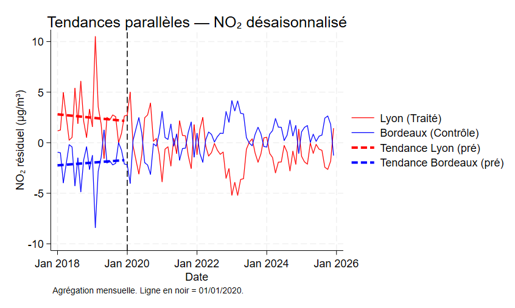

# The Causal Impact of Low Emission Zones on Air Pollution — Lyon vs. Bordeaux (2018–2025)

Did Lyon's Low Emission Zone (*Zone à Faibles Émissions*, ZFE) actually reduce nitrogen dioxide pollution, or was the decline driven by weather and the natural renewal of the vehicle fleet?

This empirical project answers that question with a **difference-in-differences** design, using Bordeaux — a comparable city with a later and less strict LEZ — as the control group.

*M1 Economics / Econometrics empirical project — Aix-Marseille School of Economics (AMSE), 2025–2026.*
*Authors: Gildas EDENAKPO & Faïzath ELEKOUN.*

📄 **[Read the full report (PDF)](report/LEZ_Impact_Lyon_Bordeaux_report.pdf)**

---

## Key findings

- After controlling for weather, the LEZ is associated with an **additional reduction of about 5.5 µg/m³ in NO₂** in Lyon relative to Bordeaux (significant at the 10% level, p = 0.094).
- The raw comparison of means points the same way: NO₂ fell by 11.5 µg/m³ in Lyon versus 5.8 µg/m³ in Bordeaux, a difference of −5.75 µg/m³.
- **Pre-treatment trends are parallel**: the Lyon × time-trend interaction before 2020 is not significant (p = 0.772), supporting Bordeaux as a valid counterfactual.
- A **placebo test** that moves the policy date one year earlier (January 2019) finds no effect (p = 0.476).
- **Wind speed** is the strongest weather driver of daily NO₂ (p < 0.001), consistent with its role in pollutant dispersion.



*Monthly deseasonalised NO₂ residuals. The dashed vertical line marks the LEZ introduction in Lyon (January 2020); dashed lines show the pre-treatment trends.*

---

## Data

| Source | Content |
|---|---|
| **Géod'air** (French national air-quality database) | Daily NO₂ concentrations from traffic and urban monitoring stations |
| **Meteostat** (Météo-France stations) | Daily average temperature, precipitation, wind speed and pressure |

The two sources were merged by date and city into a **balanced daily panel of 25,858 observations** covering 2018–2025.

## Method

The baseline specification is:

$$
NO_{2,it} = \alpha + \beta_1 \, Treated_{i} + \beta_2 \, Post_{t} + \beta_3 \, (Treated_{i} \times Post_{t}) + \gamma X_{it} + \varepsilon_{it}
$$

- `Treated` = 1 for Lyon, 0 for Bordeaux
- `Post` = 1 from the LEZ introduction (January 2020)
- `β3` is the difference-in-differences estimate of the LEZ effect
- `X` contains the meteorological controls

Analysis steps:

1. Descriptive statistics and a raw 2×2 comparison of means
2. Parallel-trends check, visual and with a test on pre-treatment interaction terms
3. Regression on deseasonalised NO₂ with meteorological controls and robust standard errors
4. Temporal placebo test with a fake treatment date

All estimations were carried out in **Stata**.

## Limitations

- **No traffic data:** harmonised traffic counts were not available for both cities over the whole period.
- **Possible spillovers:** non-compliant vehicles may have shifted to roads outside the zone, which traffic stations inside the LEZ would not capture.
- **Moderate precision:** the main effect is significant at 10% but not at 5%.

## Repository structure

```
├── README.md
├── report/
│   └── LEZ_Impact_Lyon_Bordeaux_report.pdf   # Full research report
└── figures/
    └── parallel_trends.png                    # Parallel trends graph
```

## Skills demonstrated

Causal inference (difference-in-differences, parallel trends, placebo tests) · Panel data construction and cleaning · Merging administrative and weather data · Stata · Public policy evaluation

## References

The full bibliography, including Wolff (2014) and Holman, Harrison & Querol (2015), is in the report.
